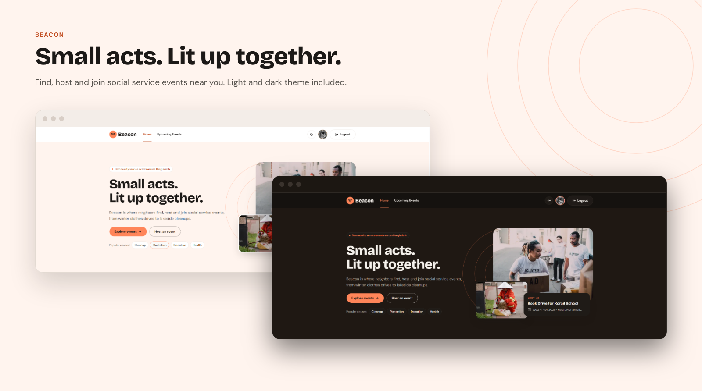
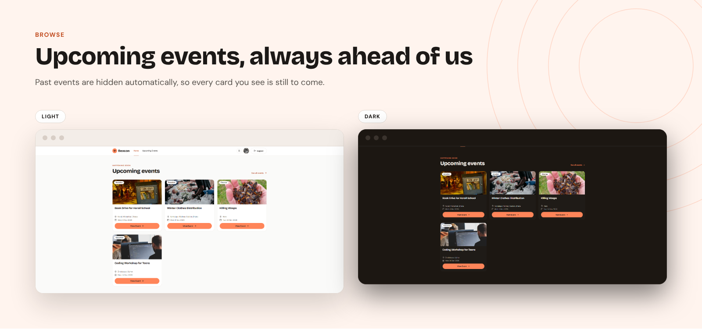
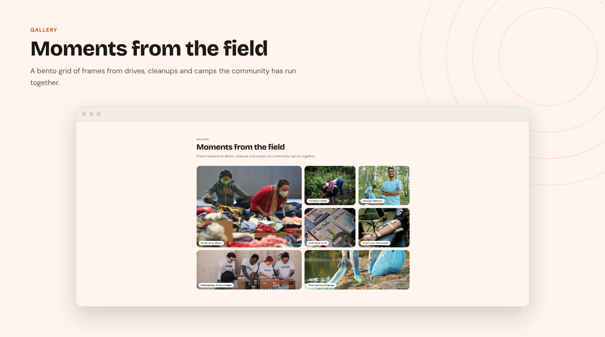
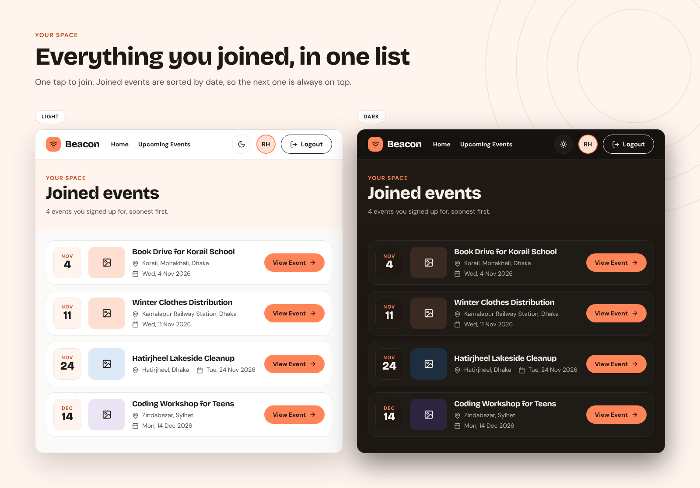
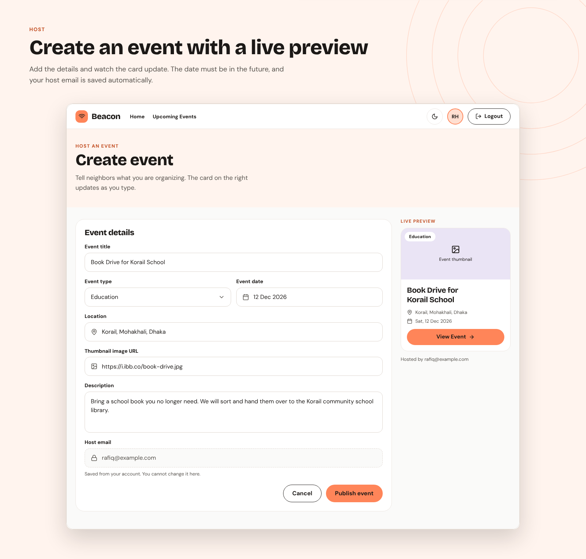

# Beacon

**Small acts. Lit up together.**

Beacon is a community board for social service events across Bangladesh. Neighbors find, host and join local causes like winter clothes drives, lakeside cleanups, plantation days and blood donation camps.

**Live site:** [https://beacon-samz.vercel.app/](https://beacon-samz.vercel.app/)



## Features

- **Browse upcoming events** — past events are hidden automatically, so every card is still to come. Filter by cause: Cleanup, Plantation, Donation, Health or Education.
- **Email and Google login** — register with name, email, photo URL and password (live checks for 6+ characters, an uppercase and a lowercase letter), or continue with Google.
- **Host events with a live preview** — the event card updates as you type, the date picker only allows future dates, and your host details are saved from your account.
- **Manage your events** — see your upcoming and past events with stats, update any upcoming event in a pop-up form, and delete events after a confirmation.
- **Join with one tap** — join or leave any event, and find everything you joined in one list sorted by date.
- **Protected by JWT** — every action that changes data sends a signed token, and the server checks that only the host can update or delete their event.
- **Light and dark theme** — one toggle switches the whole app.
- **Profile page** — update your name and photo, and see how many events you joined and hosted.

## Screenshots

### Upcoming events
Every card links to the event details page, where you can join.



### Gallery
A bento grid of moments from drives, cleanups and camps on the home page.



### Joined events
Everything you signed up for, soonest first.



### Create an event
Fill in the details and watch the preview card update.



## Pages

| Route | Access | What it does |
|---|---|---|
| `/` | Public | Banner, features, 6 upcoming events, gallery, newsletter |
| `/upcoming-events` | Public | All upcoming events with category filters |
| `/upcoming-events/[id]` | Public | Event details with join / leave (login needed to join) |
| `/login`, `/register` | Public | Email/password and Google login |
| `/create-event` | Private | Create an event with a live preview |
| `/manage-events` | Private | Update and delete the events you host |
| `/joined-events` | Private | Events you joined, sorted by date |
| `/profile` | Private | Update your name and photo |

## Tech stack

- **Framework:** Next.js 16 (App Router), React 19, TypeScript
- **UI:** Tailwind CSS v4, shadcn/ui (Base UI), lucide-react icons, sonner toasts, next-themes
- **Auth:** Better Auth with the MongoDB adapter, Google login and the JWT plugin
- **Backend:** Express + MongoDB, JWT verification with `jose` — see the [server repository](https://github.com/Samz6293/ph-assignment-8-server)

## Run it locally

1. Clone the repo and install packages:

   ```bash
   git clone https://github.com/Samz6293/ph-assignment-8-client.git
   cd ph-assignment-8-client
   npm install
   ```

2. Create a `.env` file in the project root:

   ```env
   BETTER_AUTH_URL=http://localhost:3000
   BETTER_AUTH_SECRET=your_secret
   DATABASE_URI=your_mongodb_connection_string
   GOOGLE_CLIENT_ID=your_google_client_id
   GOOGLE_CLIENT_SECRET=your_google_client_secret
   NEXT_PUBLIC_BACKEND_URL=http://localhost:8080
   ```

3. Start the [server](https://github.com/Samz6293/ph-assignment-8-server) on port 8080, then run the client:

   ```bash
   npm run dev
   ```

4. Open [http://localhost:3000](http://localhost:3000).
